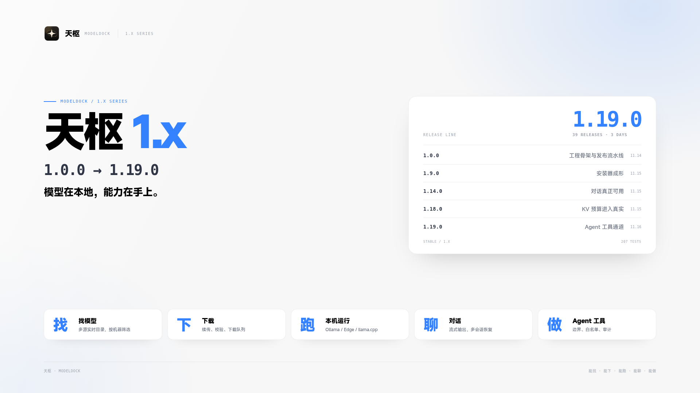

<p align="center">
  
</p>

<h1 align="center">天枢 / ModelDock</h1>

<p align="center">
  <strong>ModelDock UI</strong> · 前端源码开源 · Windows 完整应用可下载<br />
  React 19 + TypeScript + Vite 的 Windows 桌面端界面
</p>

<p align="center">
  <code>v3.6.1</code> · <code>MIT</code>
</p>

<p align="center">
  <a href="https://github.com/wang-stares/modeldock-ui/releases/latest"><strong>下载 Windows 完整应用 →</strong></a>
</p>

<p align="center">
  
</p>

## 下载

Windows 安装包与免安装压缩包见 **[Releases](https://github.com/wang-stares/modeldock-ui/releases/latest)**。

- `Tianshu-Setup-3.6.1-x64.exe`：安装版
- `Tianshu-3.6.1-win64.zip`：免安装版，解压后双击 `Tianshu.exe`
- `SHA256SUMS.txt`：下载校验

Releases 中的二进制是完整应用构建产物，**不包含源码**；后端、推理、下载、Agent 工具、安装器与发布流水线源码仍不公开。

> 历史版本：1.0.0 → 3.6.1 共 93 个版本已镜像到 Releases。1.0.0 / 1.0.1 是规则里程碑，只有版本记录，不含应用安装包；从 1.1.0 起提供 Windows 应用包。

> 历史版本的免安装 zip 已移除调试符号（`.pdb`）；下载校验以 Release 内的 `SHA256SUMS.txt` 为准。

> 视频回顾的是 1.x 的演进；这里下载的是当前完整版 3.6.1。

## 这是什么

这是「天枢 / 星坞 StarDock」桌面应用的**前端界面**仓库，也是当前 Windows 完整应用的公开下载入口。

本仓库的源码只包含界面层：页面、组件、样式、前端状态与本地交互。以下内容**不在本仓库**，也不提供源码：

- 本地后端、模型目录服务、下载队列与完整性校验
- 推理路由、模型加载、会话存储与 Agent 工具执行
- 安装器、发布流水线、签名与构建产物

前端通过 HTTP API 与本地后端通信；没有后端时界面可以启动，但模型库、对话、下载等功能会处于未连接或空状态。

## 开发

要求 Node.js 20+。

```bash
npm install
npm run dev      # http://127.0.0.1:1420
npm run build
npm run preview
```

`npm run build` 只构建前端静态资源，不包含桌面壳、安装包或后端。

## 目录

```text
src/
  components/   通用界面组件
  pages/        模型库、对话、下载中心、设置等页面
  styles/       设计令牌与全局样式
  data/         前端展示数据
  api.ts        前端 HTTP 客户端
  types.ts      前端类型定义
```

## 设计语言

- 浅色底：`#F7F7F7`
- 主色：`#3482FF`
- 圆角：16px 为主
- 字体：MiSans VF
- 状态色与字阶统一由 `src/styles/global.css` 的设计令牌控制

## 许可

前端代码以 MIT 许可发布，见 [LICENSE](LICENSE)。

Releases 中的完整应用二进制、后端与安装器源码不因本仓库的 MIT 许可而开源，相关权利保留。

「天枢」「星坞 StarDock」「ModelDock」名称、图标与品牌视觉不在 MIT 许可范围内；如需再分发产品或使用品牌标识，请先获得授权。
